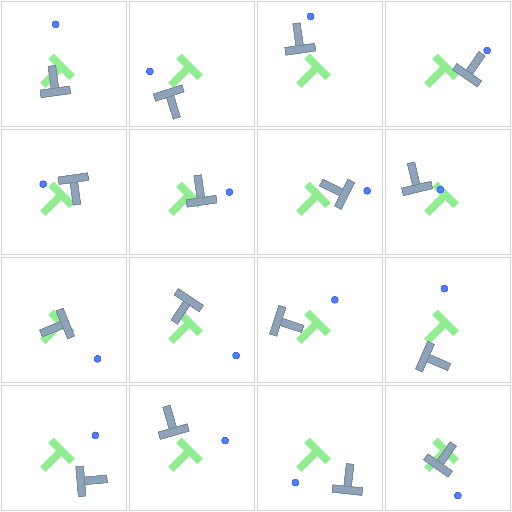
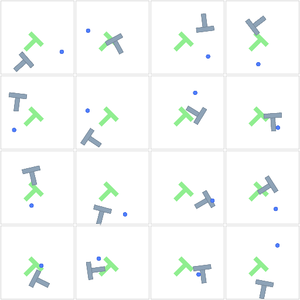

# pusht-jax

Push-T in pure JAX, as [`jax_pomdps`](https://github.com/mishmish66/jax-pomdps) POMDPs. The package
publishes only registry names.

Everything here is a copy. The task, its dynamics, reward and scene, and the demonstrations were invented, built and
recorded by the people listed under [Credits](#credits); this repository only re-expresses their work in JAX.



```python
import jax, jax.numpy as jnp, jax_pomdps

env = jax_pomdps.make("pusht_jax:push-t/pix")
key = jax.random.key(0)
state = jax.vmap(env.reset)(jax.random.split(key, 1024))
action = jnp.zeros((1024, 2))  # in [-1, 1]; 0 targets the arena center
next_state = jax.vmap(env.step, (None, 0, 0))(key, state, action)
reward = jax.vmap(env.reward, (None, 0, 0, 0))(key, state, action, next_state)
obs = jax.vmap(env.observe, (None, 0, 0))(key, next_state, action)  # (1024, 96, 96, 3) uint8
```

Names join words with dashes, and variants follow slashes: task variants first, then observation variants.

| name | randomized each episode |
|---|---|
| `push-t` | start |
| `push-t/com` | start, block center of mass |
| `push-t/goal` | start, goal pose |
| `push-t/com-goal` | start, block center of mass, goal pose |

Each name observes state; append `/kpt` for keypoints or `/pix` for 96×96 pixels (e.g. `push-t/com-goal/pix`).
Goal-randomized observations include the goal; the center of mass is unobserved. Actions in `[-1, 1]^2` target the
agent across the arena, the reward is coverage minus one, and an episode is done once coverage exceeds 0.95.

## Demonstrations

`demos.npz` is the 206 `lerobot/pusht_keypoints` demonstrations.
Episode `i` starts at `env.reset_to_pose(agent_pos[i, 0], block_pose[i, 0])`
Stepping through `action[i, :lengths[i] - 1]` is done exactly on the last step.

## PPO



State-observation PPO with no entropy bonus, 1024 envs per seed, 64-step rollouts
and a 300-step horizon trains 16 seeds for 300M steps each in about 4 minutes on one RTX 5090. The best seed succeeds
on 99.6% of 256 random resets, including all 16 shown.

## Credits

- **Push-T**: Cheng Chi, Siyuan Feng, Yilun Du, Zhenjia Xu, Eric Cousineau, Benjamin Burchfiel and Shuran Song,
  "Diffusion Policy: Visuomotor Policy Learning via Action Diffusion", RSS 2023; extended by Cheng Chi, Zhenjia Xu,
  Siyuan Feng, Eric Cousineau, Yilun Du, Benjamin Burchfiel, Russ Tedrake and Shuran Song, *IJRR* 2024. The paper
  adapts the task from Implicit Behavioral Cloning: Pete Florence, Corey Lynch, Andy Zeng, Oscar Ramirez, Ayzaan
  Wahid, Laura Downs, Adrian Wong, Johnny Lee, Igor Mordatch and Jonathan Tompson, CoRL 2021.
- **gym-pusht**, whose implementation and scene are ported here: Rémi Cadène, Quentin Gallouédec, Alexander Soare and
  Simon Alibert, Hugging Face, 2024.
- **The demonstrations**: recorded for Diffusion Policy by its authors, and published as `lerobot/pusht_keypoints`
  by LeRobot: Remi Cadene, Simon Alibert, Alexander Soare, Quentin Gallouedec, Adil Zouitine, Steven Palma, Pepijn
  Kooijmans, Michel Aractingi, Mustafa Shukor, Dana Aubakirova, Martino Russi, Francesco Capuano, Caroline Pascal,
  Jade Choghari, Khalil Meftah, Maxime Ellerbach, Jess Moss and Thomas Wolf, "LeRobot: State-of-the-art Machine
  Learning for Real-World Robotics in Pytorch", 2024.
- **Chipmunk2D**, whose space step `physics.py` reimplements: Scott Lembcke and Howling Moon Software; run in
  gym-pusht through **pymunk**, by Victor Blomqvist. Its methods are Erin Catto's: "Iterative Dynamics with Temporal
  Coherence" (GDC 2005) and "Fast and Simple Physics using Sequential Impulses" (GDC 2006).
- **JAX** and **Pallas**: James Bradbury, Roy Frostig, Peter Hawkins, Matthew James Johnson, Chris Leary, Dougal
  Maclaurin, George Necula, Adam Paszke, Jake VanderPlas, Skye Wanderman-Milne and Qiao Zhang, "JAX: composable
  transformations of Python+NumPy programs", 2018.
- The policy above trains with **PPO**: John Schulman, Filip Wolski, Prafulla Dhariwal, Alec Radford and Oleg Klimov,
  "Proximal Policy Optimization Algorithms", arXiv:1707.06347, 2017.

Licenses: the ported parts and the demonstrations keep their licenses (gym-pusht's and the dataset's Apache 2.0,
Diffusion Policy's, Chipmunk2D's and pymunk's MIT), with full texts and a file-by-file account in
[THIRD_PARTY_NOTICES.md](THIRD_PARTY_NOTICES.md). Only the new material is under [LICENSE](LICENSE).

## Development

`jax_pomdps` is installed from <https://github.com/mishmish66/jax-pomdps>.

```
uv sync                 # CPU
uv sync --extra cuda    # GPU
uv run pytest
```
